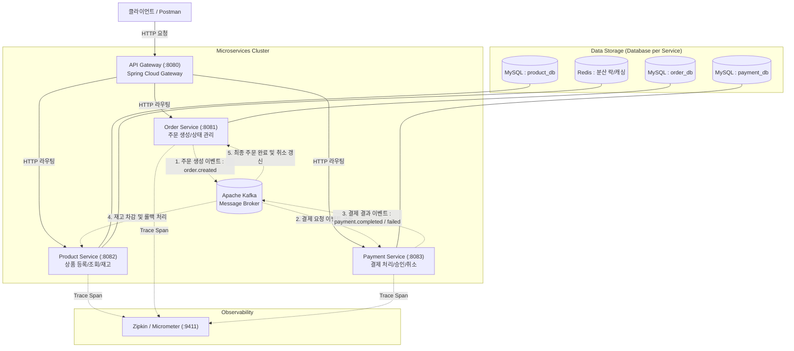
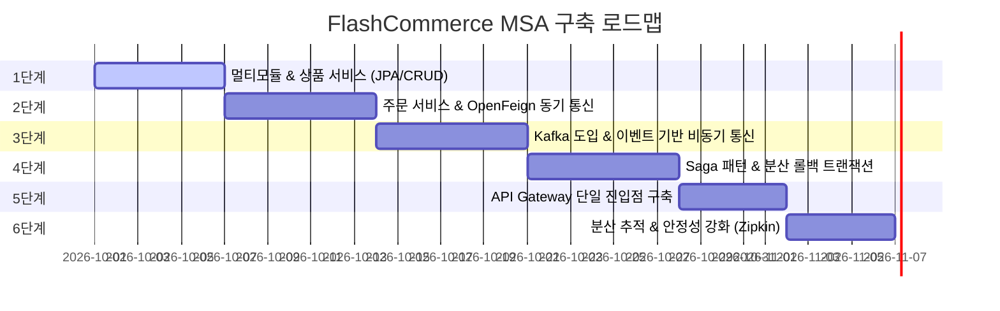

# 🛒 E-Commerce Microservices Architecture (MSA) PRD
> **프로젝트명**: FlashCommerce MSA (가칭)  
> **목표**: Spring Boot 3.x, Apache Kafka, Docker를 활용한 실전 마이크로서비스 아키텍처 구축 및 분산 시스템 핵심 패턴 체득  
> **문서 버전**: v1.0.0  
> **작성일**: 2026-10-06  

---

## 1. 프로젝트 개요 & 목적 (Overview & Goals)

### 1.1 배경 및 목적
모놀리식(Monolithic) 아키텍처에서 서비스 규모가 커짐에 따라 발생하는 빌드/배포 병목, 도메인 간 결합도 증가, 부분 장애의 전파 문제를 해결하기 위해 **마이크로서비스 아키텍처(MSA)**를 도입합니다.
본 프로젝트의 주 목적은 단순히 서비스를 물리적으로 분리하는 것을 넘어, **분산 환경의 본질적 난제(데이터 정합성, 네트워크 지연, 서비스 장애 전파, 분산 트랜잭션)**를 올바른 아키텍처 패턴으로 해결하는 경험을 쌓는 것입니다.

### 1.2 핵심 학습 및 달성 목표
1. **Spring Boot 3.x & Java 21 기반 서비스 개발**: Python(FastAPI/Django) 배경에서 Spring 생태계의 계층형 아키텍처(Controller-Service-Repository) 및 JPA 완벽 적응
2. **독립된 데이터베이스 (Database per Service)**: 서비스 간 DB 직접 참조 금지 및 API/이벤트를 통한 통신 강제
3. **동기(Sync) vs 비동기(Async) 통신의 차이 체감**: HTTP(OpenFeign)의 강결합 문제점을 경험하고 Kafka 기반 이벤트 드리븐(EDA)으로 전환
4. **분산 트랜잭션 관리 (Saga Pattern)**: 2PC(Two-Phase Commit)의 한계를 극복하고 보상 트랜잭션(Compensating Transaction)을 통한 결과적 일관성(Eventual Consistency) 달성
5. **동시성 제어**: 한정된 재고 수량에 대한 동시 주문 충돌 방지 (Redis 분산 락 or 비관적/낙관적 락)
6. **관측성(Observability)**: 단일 진입점(API Gateway) 및 분산 추적(Distributed Tracing) 구축

---

## 2. 시스템 아키텍처 및 기술 스택 (Architecture & Tech Stack)

### 2.1 전체 시스템 구조도

### 2.2 기술 스택 선정

| 계층 | 기술 | 선정 이유 |
| :--- | :--- | :--- |
| **언어 & 프레임워크** | **Java 21 LTS + Spring Boot 3.3.x** | 최신 Java 기능(Virtual Thread, Record DTO) 및 강력한 엔터프라이즈 생태계 활용 |
| **빌드 도구** | **Gradle (Kotlin or Groovy DSL)** | 멀티 모듈 구성 및 서브 모듈 간 공통 의존성 관리 용이성 |
| **API Gateway** | **Spring Cloud Gateway** | 비동기 Non-blocking(Netty 기반) 라우팅, 공통 필터(헤더, Trace ID) 처리 |
| **데이터베이스** | **MySQL 8.0 (Service per DB)** | RDBMS 트랜잭션 보장, 각 서비스별 격리된 컨테이너 구성 |
| **ORM / 영속성** | **Spring Data JPA (Hibernate)** | 객체 지향적 도메인 모델링 및 생산성 향상 |
| **메시지 브로커** | **Apache Kafka (KRaft 모드)** | 대규모 이벤트 스트리밍, 안정적인 분산 큐 및 재생(replay) 가능성 |
| **캐시 & 분산 락** | **Redis (Redisson)** | 상품 캐싱 및 재고 차감 시 분산 락 구현 |
| **인프라 & 컨테이너** | **Docker & Docker Compose** | 로컬 환경에서 모든 서비스 및 미들웨어의 단일 명령 실행 |
| **분산 추적** | **Micrometer Tracing + Zipkin** | 마이크로서비스 간 요청 흐름 시각화 및 병목 지점 탐색 |

---

## 3. 서비스별 상세 도메인 요구사항 (Service Specifications)

### 3.1 공통 모듈 (`common`)
* **역할**: 각 서비스에서 중복으로 작성되는 DTO, 공통 에러 응답 객체, Kafka 이벤트 메시지 스키마 정의
* **주요 구성**:
  * `ApiResponse<T>`: 일관된 JSON 응답 래퍼
  * `CustomException` & 전역 핸들러 베이스
  * Event DTOs: `OrderCreatedEvent`, `PaymentCompletedEvent`, `PaymentFailedEvent`, `StockDeductedEvent` 등

### 3.2 상품 서비스 (`product-service` / 포트: 8082)
* **역할**: 상품 정보 관리 및 재고(Inventory) 증감 제어
* **핵심 기능**:
  1. 상품 등록 / 단건 조회 / 목록 조회 (페이징)
  2. 재고 확인 및 선점/차감 (동시성 제어 적용)
  3. 결제 실패 시 보상 트랜잭션으로 차감된 재고 복구
* **주요 엔드포인트**:
  * `POST /api/v1/products`: 상품 등록
  * `GET /api/v1/products/{id}`: 상품 상세 조회
  * `GET /api/v1/products`: 상품 목록 조회
  * `POST /api/v1/products/{id}/deduct-stock`: 재고 차감 (내부 호출용)

### 3.3 주문 서비스 (`order-service` / 포트: 8081)
* **역할**: 고객의 주문 라이프사이클 관리 및 Saga 트랜잭션 시작점
* **주문 상태 머신**: `PENDING`(대기) → `PAYMENT_REQUESTED`(결제요청) → `CONFIRMED`(완료) / `CANCELLED`(취소)
* **핵심 기능**:
  1. 주문 생성 요청 수신 (`POST /api/v1/orders`)
  2. 주문 상태를 `PENDING`으로 저장 후 `order.created` 이벤트 발행
  3. 결제 결과 및 재고 차감 이벤트를 수신하여 주문 상태를 최종 업데이트
  4. 주문 내역 단건/목록 조회
* **주요 엔드포인트**:
  * `POST /api/v1/orders`: 주문 요청
  * `GET /api/v1/orders/{id}`: 주문 상태 조회
  * `GET /api/v1/orders/user/{userId}`: 사용자별 주문 내역

### 3.4 결제 서비스 (`payment-service` / 포트: 8083)
* **역할**: 결제 승인/거절 모의(Mocking) 처리 및 결제 내역 관리
* **핵심 기능**:
  1. 주문 생성 이벤트를 구독하여 결제 트랜잭션 수행
  2. 금액 검증 및 모의 결제 성공/실패 판정 (테스트를 위해 특정 조건에서 강제 실패 유도 가능)
  3. 멱등성(Idempotency) 보장: 동일 주문 ID로 중복 결제 요청 시 단 1회만 처리
  4. `payment.completed` 또는 `payment.failed` 이벤트 발행
* **주요 엔드포인트**:
  * `GET /api/v1/payments/{orderId}`: 주문별 결제 내역 조회

### 3.5 API 게이트웨이 (`api-gateway` / 포트: 8080)
* **역할**: 외부 클라이언트의 단일 진입점, 요청 라우팅, 공통 로깅 및 요청 추적 ID 발급
* **핵심 기능**:
  1. URL Path 기반 라우팅:
     * `/api/v1/products/**` → `product-service` (:8082)
     * `/api/v1/orders/**` → `order-service` (:8081)
     * `/api/v1/payments/**` → `payment-service` (:8083)
  2. Global Filter: 각 요청에 `X-Correlation-ID`(추적 ID) 부여 및 헤더 전파

---

## 4. 단계별 구현 로드맵 (Phased Roadmap & WBS)

각 단계(Phase)가 완료될 때마다 실제로 동작하는 결과물을 검증하고 다음 단계로 진행합니다.

---

### [Phase 1] 프로젝트 베이스라인 & 상품 서비스 구축
> **목표**: Gradle 멀티 모듈 세팅, 로컬 DB 환경 구축, Spring Boot 기본기(JPA, RestController) 습득

- [ ] **Task 1.1**: 루트 Gradle 멀티 모듈 구성 (`settings.gradle`, `build.gradle`, `.gitignore`)
- [ ] **Task 1.2**: `common` 모듈 생성 (공통 응답 래퍼 `ApiResponse`, 전역 예외 처리 클래스)
- [ ] **Task 1.3**: `docker-compose.yml` 작성 (MySQL 3개 컨테이너 or 1개 인스턴스 내 3개 스키마 분리)
- [ ] **Task 1.4**: `product-service` 생성 및 Spring Data JPA 설정
- [ ] **Task 1.5**: 상품 등록, 상세 조회, 목록 조회 CRUD API 구현
- [ ] **Task 1.6**: API 동작 테스트 (Curl / HTTP Client)

---

### [Phase 2] 주문 서비스 생성 & 동기식(HTTP) 통신의 한계 경험
> **목표**: 두 번째 마이크로서비스 구축 및 OpenFeign을 통한 동기 호출 구현, 동기 통신의 문제점 파악

- [ ] **Task 2.1**: `order-service` 모듈 생성 및 DB 스키마/엔티티 구성
- [ ] **Task 2.2**: Spring Cloud OpenFeign 의존성 추가 및 FeignClient 구현
- [ ] **Task 2.3**: 주문 요청 시 `order-service`가 `product-service`로 재고 확인/차감 HTTP 동기 호출
- [ ] **Task 2.4**: 동기 통신의 결합도 테스트
  * *실험*: `product-service`를 중단시켰을 때 `order-service`에서 발생하는 타임아웃 및 전체 장애 전파 확인

---

### [Phase 3] 메시지 브로커(Kafka) 도입 & 이벤트 기반 아키텍처(EDA) 전환
> **목표**: 비동기 메시징을 통한 서비스 간 결합도 분리 및 결제 서비스 연동

- [ ] **Task 3.1**: `docker-compose.yml`에 Apache Kafka (KRaft 모드) 추가 및 기동
- [ ] **Task 3.2**: `payment-service` 모듈 생성 및 결제 엔티티/DB 연동
- [ ] **Task 3.3**: Kafka Producer / Consumer 공통 설정 및 JSON 직렬화/역직렬화 구성
- [ ] **Task 3.4**: 주문 시 `order.created` 이벤트 발행 → `payment-service`에서 수신하여 결제 처리
- [ ] **Task 3.5**: 결제 완료 후 `payment.completed` 이벤트 발행 확인

---

### [Phase 4] 분산 트랜잭션과 Saga 패턴 (Choreography Saga)
> **목표**: 분산 환경에서 결제 실패 또는 재고 부족 시 데이터 일관성을 지키는 보상 트랜잭션 완성

- [ ] **Task 4.1**: 이벤트 기반 트랜잭션 시나리오 정의 (성공 / 잔액부족 실패 / 재고부족 실패)
- [ ] **Task 4.2**: `product-service`에서 결제 완료 이벤트를 받아 최종 재고 차감 처리
- [ ] **Task 4.3**: 결제 실패(`payment.failed`) 이벤트 수신 시 `order-service`에서 주문 취소(`CANCELLED`) 상태 변경
- [ ] **Task 4.4**: 재고 부족 시 결제 취소 보상 이벤트 발행 및 처리
- [ ] **Task 4.5**: 결제 서비스의 멱등성(Idempotent Consumer) 보장 로직 구현

---

### [Phase 5] API Gateway 단일 진입점 & 라우팅
> **목표**: 클라이언트가 서비스별 포트를 알 필요 없이 8080 포트 하나로 모든 API를 사용하도록 통합

- [ ] **Task 5.1**: `api-gateway` 모듈 생성 (Spring Cloud Gateway)
- [ ] **Task 5.2**: 라우팅 규칙 설정 (`/api/v1/products/**`, `/api/v1/orders/**`, `/api/v1/payments/**`)
- [ ] **Task 5.3**: Global Filter 구현 (요청 로깅 및 `X-Correlation-ID` 헤더 자동 생성/주입)
- [ ] **Task 5.4**: Gateway를 통한 End-to-End 주문/결제 통합 흐름 테스트

---

### [Phase 6] 분산 추적(Distributed Tracing) 및 시스템 안정성 강화
> **목표**: 여러 서비스로 분산된 요청 흐름을 한눈에 추적하고 장애 발생 시 시스템 회복력 확보

- [ ] **Task 6.1**: `docker-compose.yml`에 Zipkin 컨테이너 추가
- [ ] **Task 6.2**: 전 서비스에 Micrometer Tracing + Brave/Zipkin 연동
- [ ] **Task 6.3**: 주문 요청 1건이 Gateway → Order → Kafka → Payment/Product로 흐르는 추적 로그 확인
- [ ] **Task 6.4**: Redis를 이용한 인기 상품 캐싱 또는 선착순 재고 분산 락(Redisson) 적용

---

## 5. 성공 기준 및 검증 방법 (Definition of Done)

1. **독립 실행성**: `docker compose up -d` 명령어 하나로 모든 DB, Kafka, Zipkin 인프라가 문제없이 실행된다.
2. **서비스 격리**: 각 서비스가 자신의 DB만 연결하며, 다른 서비스의 DB 접근 권한이 없다.
3. **이벤트 기반 정상 흐름**:
   * 게이트웨이(`:8080/api/v1/orders`)로 주문 요청 전송 시, Kafka 이벤트를 통해 결제 승인 및 재고 차감이 비동기로 완료되어 주문 상태가 `CONFIRMED`가 된다.
4. **장애 보상 흐름 (Saga)**:
   * 의도적으로 결제 실패(예: 금액 초과 또는 테스트 플래그)를 유도했을 때, 주문이 `CANCELLED` 상태로 자동 전이되고 차감된 재고가 정상 복구된다.
5. **추적 가능성**: Zipkin 대시보드(`:9411`)에서 해당 주문의 Trace ID를 검색하면 서비스 간 호출 흐름과 소요 시간을 타임라인으로 확인할 수 있다.
